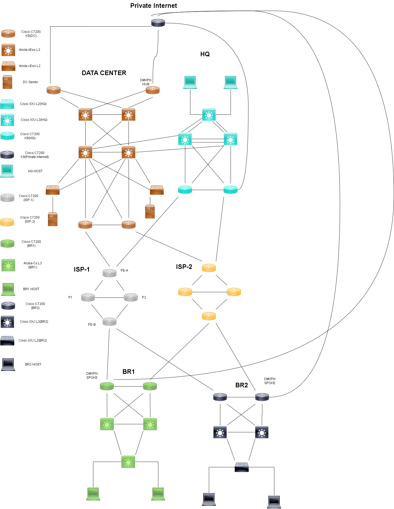

# 🏆 멀티벤더 하이브리드 네트워크 구축

[](https://github.com/KSNAM97)
[](https://github.com/KSNAM97)
[](https://github.com/KSNAM97)

**ISP 이중화 iBGP Route Reflector · DMVPN Phase3 (mGRE over IPsec) · OSPF · VRRP · MSTP · QoS · 화이트리스트 ACL — Cisco + Arista 멀티벤더 4개 사이트 WAN 종합 구축**

---

## 📖 About

| 항목 | 내용 |
| --- | --- |
| 주제 | HQ / DC / BR1 / BR2 4개 사이트를 ISP 이중화와 DMVPN으로 연결하는 멀티벤더 하이브리드 네트워크 |
| 장비 구성 | HQ (HQ-R1·HQ-R2, HQ-SW-1 – HQ-SW-3), DC (DC-R1 – DC-R4, DC-SW1 – DC-SW4-L3, DC-SW1·2-L2, DC-DNS-1·DC-DNS-2), BR1 (BR1-R1·R2, BR1-SW1 ~ SW3-L3), BR2 (BR2-R1·R2, BR2-SW1·SW2-L3, BR2-SW3-L2), 호스트 H1·H2, ISP-1·ISP-2 (ISP-n-PE-A·P1·P2·PE-B 각 4대), Private Internet (Private-net) |
| 핵심 기술 | 사이트 OSPF, ISP iBGP Route Reflector(ISP-1 AS 65100, ISP-2 AS 65200), 정적 기본 경로 + OSPF 기본 경로 광고(IP SLA/track), DMVPN Phase3, IPsec, VRRP, MSTP, EtherChannel, QoS, ACL 화이트리스트 |
| 시뮬레이터 | GNS3 (Cisco 7200 / IOU, Arista cEOS) |
| 일정 | 3.5주(2026-10-12 ~ 11-04), 1인 체제 (남기석) |
| 검증 | 이중화 장애 실측 (FHRP, EtherChannel, ISP 장애, DMVPN Hub 장애), 트러블슈팅 로그 |

---

## 🌐 토폴로지



```text
HQ(65001) ─┬─ ISP-1 ─┐
           └─ ISP-2 ─┤
DC(65002) ─┬─ ISP-1 ─┼─ ISP 내부: iBGP RR
           └─ ISP-2 ─┤
BR1        ─┬─ ISP-1 ─┤
           └─ ISP-2 ─┤
BR2        ─┬─ ISP-1 ─┘
           └─ ISP-2 ─┘

DC ←── DMVPN Phase3 (mGRE over IPsec, Private Internet 경유) ──→ HQ, BR1, BR2
```

---

## 📁 폴더 구조

```
network-project/
├── configs/                  사이트/계층(core, distribution, access)/장비
│   ├── hq/
│   │   ├── core/             HQ-R1.ios, HQ-R2.ios
│   │   ├── distribution/     HQ-SW-2.ios, HQ-SW-3.ios
│   │   └── access/           HQ-SW-1.ios
│   ├── dc/                   core, distribution, access (Arista는 .eos)
│   ├── br1/                  core, distribution, access
│   ├── br2/                  core, distribution, access
│   ├── isp1/core/
│   ├── isp2/core/
│   └── private-internet/core/
├── verification/             장비 검증 기록(사이트/계층/프로토콜, Jira 연결)
├── docs/
│   ├── network-project-final.md
│   ├── port-mapping.md
│   ├── ip-mapping.md
│   ├── ospf-design.md
│   ├── bgp-design.md
│   ├── vlan-design.md
│   ├── vrrp-mstp-design.md
│   ├── dmvpn-design.md
│   ├── dhcp-dns-design.md
│   ├── README.md              문서 목차(하려는 일별 안내)
│   ├── config-guide/          설정 가이드(README, cisco-router, cisco-switch, arista-switch, alpine)
│   ├── schedule.md
│   └── archive/
│       ├── schedule-2person.md   (2인 체제 계획, 보관)
│       └── schedule-3person.md   (3인 체제 계획, 보관)
├── jira/
│   ├── jira-tickets-3person.csv   (현재 Jira KAN 이슈 29개의 등록 기준, 라벨 net-cloud / policy, 마감일 포함)
│   └── archive/
│       └── jira-tickets-2person.csv   (2인 체제 참고안, 보관)
├── slack/
│   └── slack-announcement.md
├── topology/
│   ├── topology-draft.drawio
│   └── topology-draft.png
├── CONTRIBUTING.md
└── README.md
```

| 폴더 | 내용 |
| --- | --- |
| `configs/` | 사이트별 장비 컨피그 (`configs/<사이트>/<계층>/<장비명>.<확장자>`(Cisco `.ios`, Arista `.eos`, 호스트 `.alp`, DNS 서버 `.sh`)) |
| `docs/` | 전체 설계(아키텍처, AS / VLAN / IP, 인터페이스 매핑, 정책, 빌드 순서), 프로토콜별 상세 설계(OSPF, BGP, VLAN, DMVPN, DHCP·DNS), 장비 설정 가이드, 일정 |
| `jira/` | Jira 티켓 목록과 마감일 (현재 Jira 이슈 기준 CSV) |
| `slack/` | 팀 공지 초안 |
| `topology/` | 토폴로지 원본(drawio)과 이미지 |

---

## 🗂️ 구성 단계 (Build Stages)

| 주차 | 단계 | 핵심 내용 |
| --- | --- | --- |
| **1주** | 설계 확정, 환경 세팅, 사이트 내부 | AS / IP / VLAN 확정, GNS3 환경, RAM 실측, 노드 배치, VLAN / 트렁크 / EtherChannel / VRRP / MSTP, 사이트 내부 OSPF, 사이트 DHCP |
| **2주** | 사이트 ↔ ISP, DMVPN | 정적 기본 경로 + OSPF 기본 경로 광고(track), Private Internet ACL, DMVPN(mGRE over IPsec), DNS, 서버 VLAN ACL |
| **3주** | 이중화 실측, ISP BGP, QoS | VRRP / EtherChannel / DMVPN Hub 장애 실측, ISP 내부 iBGP RR, ISP-1 장애 전환 실측, QoS 정책, 트러블슈팅 로그 |
| **3.5주** | 정리 | PPT 제작, 리허설 |

> 역할 분담과 일별 목표 → [`docs/schedule.md`](./docs/schedule.md)  
> 전체 설계 → [`docs/network-project-final.md`](./docs/network-project-final.md)

---

## 🔑 핵심 설계 포인트

### 사이트 · AS

| 사이트 | AS | 대역 | 비고 |
| --- | --- | --- | --- |
| HQ | 65001 | 10.1.0.0/16 | OSPF 프로세스 11 Area 1, DMVPN Spoke (HQ-R2) |
| DC | 65002 | 10.2.0.0/16 | OSPF 프로세스 10 Area 0, DMVPN Hub (DC-R2) |
| BR1 | 65003 | 10.3.0.0/16 | OSPF 프로세스 12 Area 2, DMVPN Spoke (BR1-R1) |
| BR2 | 65004 | 10.4.0.0/16 | OSPF 프로세스 13 Area 3, DMVPN Spoke (BR2-R2) |
| ISP-1 | 65100 | 100.1.0.0/16 | iBGP (P1, P2 Route Reflector / PE-A, PE-B Client) + ISP 내부 OSPF |
| ISP-2 | 65200 | 100.2.0.0/16 | iBGP (P1, P2 Route Reflector / PE-A, PE-B Client) + ISP 내부 OSPF |
| Private Internet | 없음 | 203.0.113.0/24 | OSPF 프로세스2 Area 100, DMVPN 언더레이 전용 |
| DMVPN 터널 | - | 172.16.0.0/24 | Area 0 (DC 프로세스 10, HQ 프로세스 11, BR1 프로세스 12, BR2 프로세스 13) |

### 라우팅 설계

- 사이트 (HQ / DC / BR1 / BR2) 내부: OSPF 전용, BGP 없음
- ISP-1 / ISP-2: ISP별 단일 AS의 iBGP Route Reflector(P1, P2 이중 RR), ISP 내부 OSPF process 1 Area 0
- 사이트 ↔ ISP: 라우팅 프로토콜 없이 정적 기본 경로 + OSPF 기본 경로 광고 (IP SLA / track)
- Private Internet: 별도 OSPF 프로세스, ACL 화이트리스트로 언더레이 트래픽만 허용
- DC 내부 스위치만 Arista cEOS, 나머지는 Cisco (7200 / IOU)

### DMVPN Phase 3

| 장비 | Tunnel0 | NBMA (source) | 역할 |
| --- | --- | --- | --- |
| DC-R2 | 172.16.0.1/24 | 203.0.113.5 | Hub, priority 255, mGRE over IPsec |
| HQ R2 | 172.16.0.13/24 | 203.0.113.9 | Spoke, priority 0, shortcut |
| BR1 R1 | 172.16.0.11/24 | 203.0.113.13 | Spoke, priority 0, shortcut |
| BR2 R2 | 172.16.0.12/24 | 203.0.113.17 | Spoke, priority 0, shortcut |

### VLAN 및 게이트웨이 이중화

| 사이트 | VLAN | 이름 | 서브넷 | 게이트웨이 이중화 |
| --- | --- | --- | --- | --- |
| HQ | 10 / 20 | HQ-PUBLIC / HQ-PRIVATE | 10.1.10.0/24, 10.1.20.0/24 | VRRP |
| DC | 50 | SERVER (DC-DNS-1, DC-DNS-2) | 10.2.50.0/24 | VRRP |
| BR1 / BR2 | 10 / 20 | BR1-PUBLIC / BR1-PRIVATE, BR2-PUBLIC / BR2-PRIVATE | 10.3.10.0/24, 10.3.20.0/24, 10.4.10.0/24, 10.4.20.0/24 | VRRP |
| 전 사이트 | 100 / 999 | MGMT / NATIVE | 10.X.100.0/24 / IP 없음 | - |

### QoS와 접근 통제

| 항목 | 내용 |
| --- | --- |
| QoS 대상 | 사이트 ↔ 스위치 라우터 인터페이스 20포트 (각 Gi0/0, Gi1/0) |
| 클래스 | CONTROL (CS6, 10%) / BUSINESS (DNS 53 → AF31, 30%) / class-default (fair-queue) |
| 제외 | 라우터 간 링크, ISP 방향, Private Internet 방향, Tunnel0 |
| Private Internet ACL | OSPF, GRE / ESP / UDP 500 (203.0.113.0/24 간), ICMP(임시)만 허용 후 `deny ip any any log` |
| DC VLAN 50 | DC-DNS-1·DC-DNS-2는 각 사이트에서 UDP / TCP 53만 허용 (DHCP는 사이트 게이트웨이에서 제공하므로 서버 VLAN으로 허용하지 않음) |

### 서버·부가 서비스

- DC 서버 VLAN50: DC-DNS-1(주), DC-DNS-2(백업) 두 대, GNS3 `DNS` 템플릿(Debian 계열) 이미지, `dnsmasq`로 DNS 제공. 주소는 `10.2.50.10`, `10.2.50.11`.
- DHCP: 사용자 VLAN 게이트웨이 스위치 두 대(IOS DHCP 서버)가 풀을 나눠 제공(앞 64개 Active, 뒤 64개 Standby). 풀은 `docs/ip-mapping.md` 5절, 구성은 `docs/dhcp-dns-design.md`.
- QoS: 사이트 스위치와 연결된 라우터 인터페이스 20포트에 적용하며 스위치(IOU L2 / cEOS) QoS는 적용하지 않음.

문서 목차: [`docs/README.md`](./docs/README.md)

상세 설계: [`docs/ospf-design.md`](./docs/ospf-design.md), [`docs/bgp-design.md`](./docs/bgp-design.md), [`docs/vlan-design.md`](./docs/vlan-design.md), [`docs/vrrp-mstp-design.md`](./docs/vrrp-mstp-design.md), [`docs/dmvpn-design.md`](./docs/dmvpn-design.md), [`docs/dhcp-dns-design.md`](./docs/dhcp-dns-design.md), [`docs/config-guide/README.md`](./docs/config-guide/README.md)

> 브랜치 전략, 커밋 규칙, Jira 연동 → [`CONTRIBUTING.md`](./CONTRIBUTING.md)
