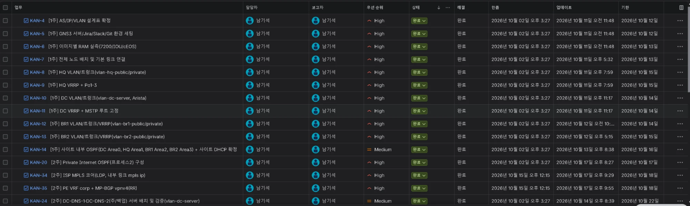

# 프로젝트 관리 (Jira, Slack)

1인 프로젝트이며 Jira 이슈와 Slack 알림으로 일정과 진행을 관리. 일정은 [`schedule.md`](./schedule.md), 이슈 등록 기준은 [`jira/jira-tickets-3person.csv`](../jira/jira-tickets-3person.csv).

## 1. Jira

Jira 목록 화면. 이슈 번호, 제목, 우선순위, 상태, 마감일, 갱신 시각이 한 화면에 표시됨.

이후 완료 처리한 이슈(KAN-15, KAN-16, KAN-36).

## 2. Slack

Jira 이슈의 생성과 상태 전환이 Slack 채널에 알림으로 전달됨. 아래는 2026-10-17의 전환 알림(KAN-20, KAN-15, KAN-16, KAN-34, KAN-35).

1주차 이슈의 완료 알림(2026-10-11).

공지와 설정 기록은 [`slack/slack-announcement.md`](../slack/slack-announcement.md), [`slack/2026-10-02-setup-summary.md`](../slack/2026-10-02-setup-summary.md).
