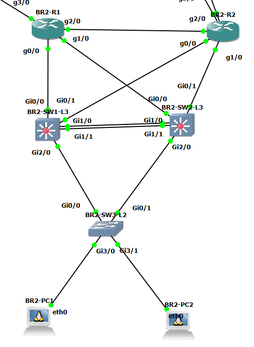

# BR2

GNS3 토폴로지(검증 대상 장비와 포트). 상세 결과는 아래 문서 링크에서 확인.

## 핵심 결과

* DHCP Wireshark DORA(Cisco, 서버 선택 관찰) → [dhcp](dhcp.md)
* DMVPN Spoke, QoS(DNS 분류) → [dmvpn](dmvpn.md), [qos](qos.md)

## 계층별 검증 문서

| 계층           | 항목              | Jira   | 문서                                            |
| ------------ | --------------- | ------ | --------------------------------------------- |
| access(L2)   | STP             | KAN-13 | [access/stp.md](stp.md)                       |
| access(L2)   | VLAN, 트렁크 검증    | KAN-13 | [access/vlan-trunk.md](vlan-trunk.md)         |
| core         | DMVPN Spoke 검증  | KAN-23 | [core/dmvpn.md](dmvpn.md)                     |
| core         | ISP 연결 검증       | KAN-18 | [core/isp-link.md](isp-link.md)               |
| core         | OSPF 검증         | KAN-14 | [core/ospf.md](ospf.md)                       |
| core         | QoS 검증          | KAN-25 | [core/qos.md](qos.md)                         |
| distribution | DHCP 검증         | KAN-14 | [distribution/dhcp.md](dhcp.md)               |
| distribution | OSPF 검증         | KAN-14 | [distribution/ospf.md](ospf-1.md)             |
| distribution | EtherChannel 검증 | KAN-13 | [distribution/po-channel.md](po-channel.md)   |
| distribution | STP             | KAN-13 | [distribution/stp.md](stp-1.md)               |
| distribution | VLAN, 트렁크 검증    | KAN-13 | [distribution/vlan-trunk.md](vlan-trunk-1.md) |
| distribution | VRRP 검증         | KAN-13 | [distribution/vrrp.md](vrrp.md)               |

상세 서식과 상태는 [검증 README](../verification.md) 참조.
