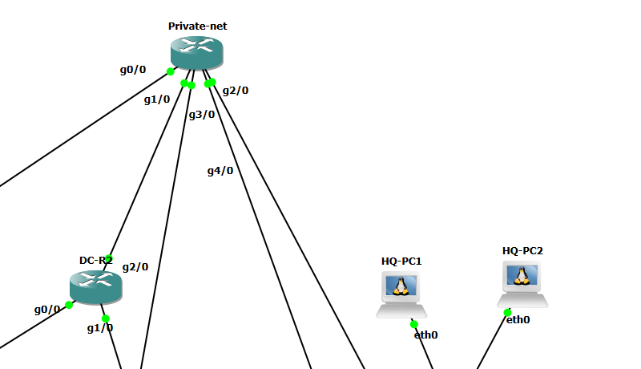

# Private Internet

GNS3 토폴로지(검증 대상 장비와 포트). 상세 결과는 아래 문서 링크에서 확인.

## 핵심 결과

* DMVPN 언더레이: Hub 장애에도 PI 구간과 이웃(`2.2.2.2`) 유지 → [dmvpn-hub-failure](../../undefined-4/dmvpn-hub-failure.md)
* PI ACL(pi-whitelist), OSPF → [acl](acl.md), [ospf](ospf.md)

## 계층별 검증 문서

| 계층   | 항목                       | Jira   | 문서                      |
| ---- | ------------------------ | ------ | ----------------------- |
| core | Private Internet ACL 검증  | KAN-19 | [core/acl.md](acl.md)   |
| core | Private Internet OSPF 검증 | KAN-20 | [core/ospf.md](ospf.md) |

상세 서식과 상태는 [검증 README](../verification.md) 참조.
