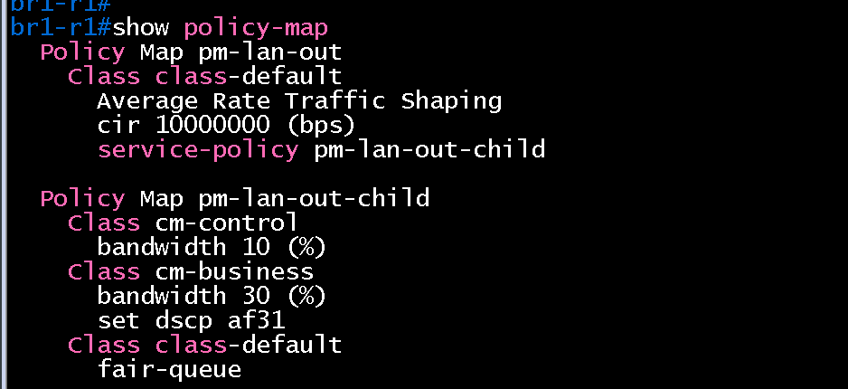
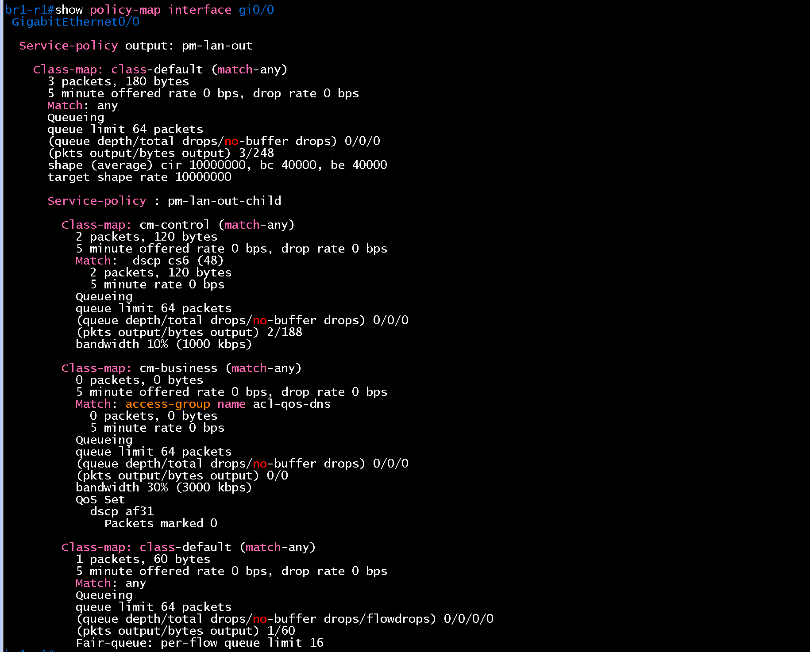
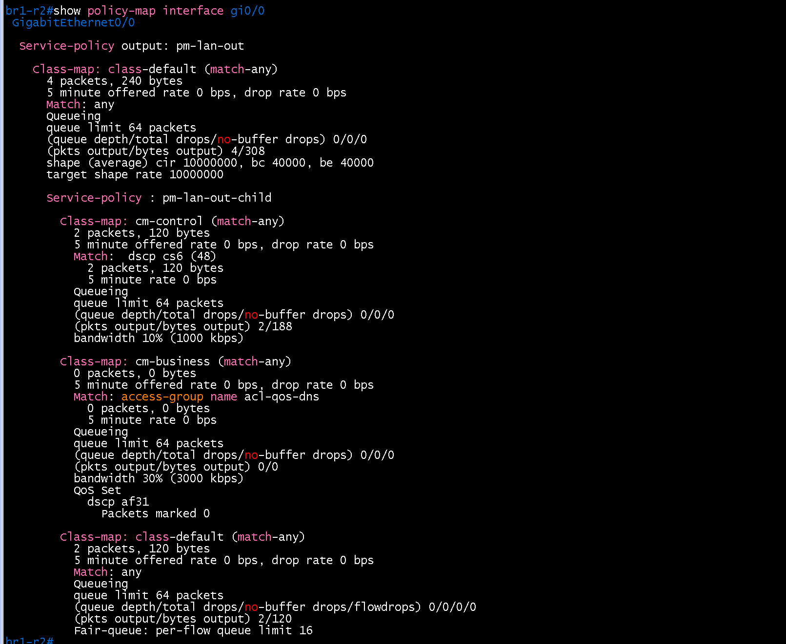

# QoS 검증 (BR1 / core)

- Jira: KAN-25
- 대상 장비: BR1-R1, BR1-R2
- 기준 문서: [qos-design.md](../../../docs/qos-design.md), [cisco-router.md](../../../docs/config-guide/cisco-router.md) 3.7절
- 검증일: 2026-10-18

| 장비 | 명령 | 기대 결과 | 실제 결과 | 판정 |
|---|---|---|---|---|
| BR1-R1, BR1-R2 | `show policy-map` | 정책 `pm-lan-out`, `pm-lan-out-child` 정의, 클래스 `cm-control`, `cm-business`, `class-default` | 두 장비 모두 `pm-lan-out`(class-default `shape average cir 10000000`, `service-policy pm-lan-out-child`)과 `pm-lan-out-child`(`cm-control` bandwidth 10%, `cm-business` bandwidth 30%와 `set dscp af31`, `class-default` fair-queue) 정의 | 통과 |
| BR1-R1, BR1-R2 | `show policy-map interface gi0/0`, `gi1/0` | `pm-lan-out` 출력 방향 적용, 클래스 3개 표시 | `gi0/0`에 `Service-policy output: pm-lan-out`. `shape (average) cir 10000000, bc 40000, be 40000`, `cm-control`은 `Match: dscp cs6 (48)`와 bandwidth 10%(1000 kbps), `cm-business`는 `Match: access-group name acl-qos-dns`와 bandwidth 30%(3000 kbps), `QoS Set dscp af31`, `class-default`는 `Fair-queue`. 카운터는 `cm-control`에 라우터 제어 트래픽 1~2패킷, `cm-business` 0, drop 0. `gi1/0` 출력은 보충 예정 | gi0/0 통과, gi1/0 미확인 |
| 호스트 | `nslookup` 후 `show policy-map interface` | `cm-business` 매치 패킷 증가 | - | 미확인 |
| 호스트 | 큰 트래픽(`ping -s 1400`) 후 `show policy-map interface` | `class-default`에 drop 발생, `cm-business` 보장 | - | 미확인 |
| BR1-R1, BR1-R2 | `show policy-map interface gi2/0`(해당 시) | 정책 미적용(제외 대상) | - | 미확인 |

BR1-R1 show policy-map

BR1-R1 show policy-map interface gi0/0

BR1-R2 show policy-map

BR1-R2 show policy-map interface gi0/0

