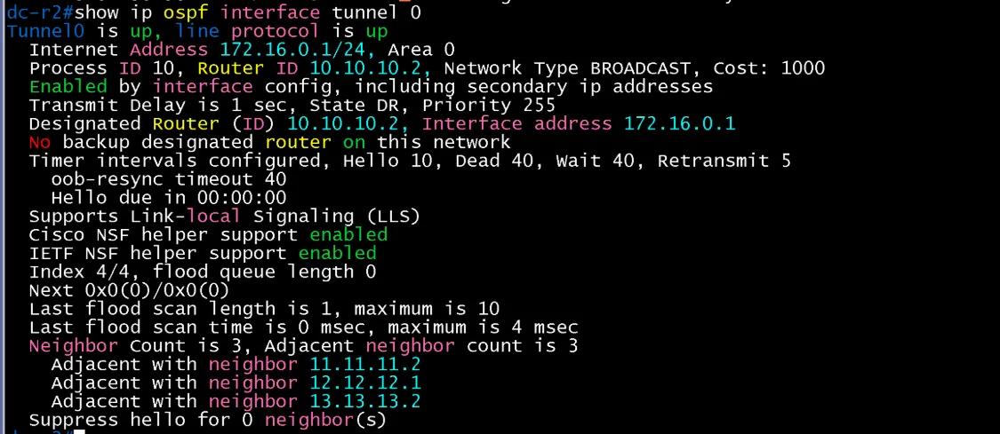

# DMVPN Hub 검증 (DC / core)

- Jira: KAN-21
- 대상 장비: DC-R2
- 기준 문서: [dmvpn-design.md](../../../docs/dmvpn-design.md) 1~4절
- 검증일: 2026-10-18

| 장비 | 명령 | 기대 결과 | 실제 결과 | 판정 |
|---|---|---|---|---|
| DC-R2 | `show dmvpn` | Spoke 3개(HQ-R2, BR1-R1, BR2-R2) Up, Tunnel0 172.16.0.1, NBMA 203.0.113.5 | - | 미확인 |
| DC-R2 | `show ip nhrp` | Spoke 3개의 터널 주소와 NBMA 매핑(dynamic) | - | 미확인 |
| DC-R2 | `show crypto isakmp sa` | Spoke별 SA QM_IDLE | - | 미확인 |
| DC-R2 | `show crypto ipsec sa` | 암호화 카운트 증가 | - | 미확인 |
| DC-R2 | `show ip ospf neighbor` | Tunnel0에서 Spoke 이웃 FULL(Hub priority 255, DR) | - | 미확인 |
| DC-R2 | `show ip ospf interface tunnel 0` | Hub priority 255, DR, Spoke 3대와 인접 | Tunnel0 up/up, 172.16.0.1/24, Area 0, 프로세스 10, Router ID 10.10.10.2, BROADCAST, State DR, Priority 255, DR는 자기 자신(10.10.10.2, 172.16.0.1). Neighbor Count 3, Adjacent neighbor 3(11.11.11.2, 12.12.12.1, 13.13.13.2) | 통과 |

DC-R2 show ip ospf interface tunnel 0

