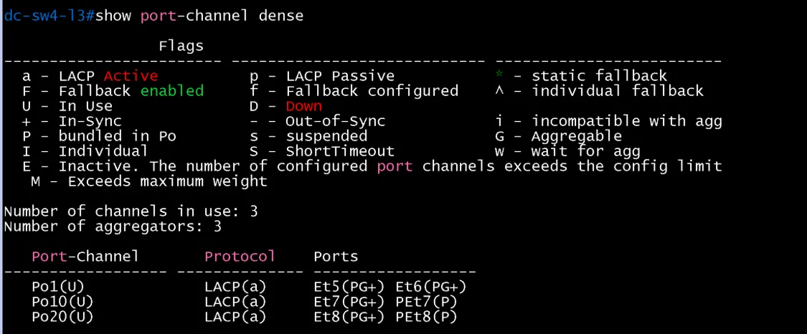
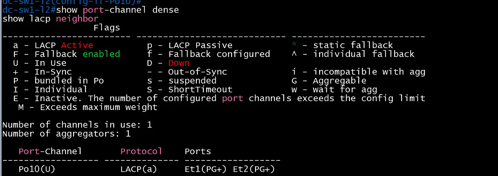
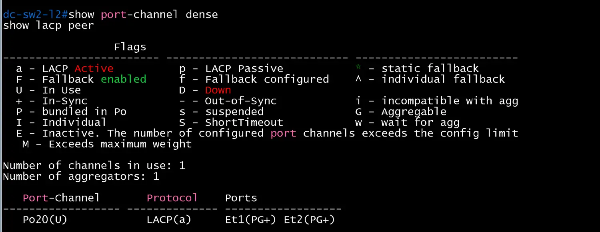
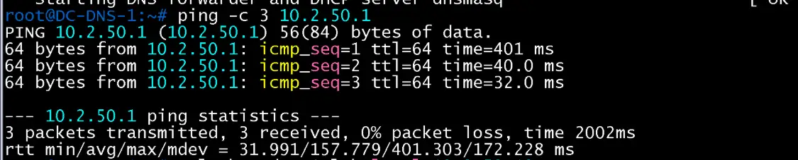
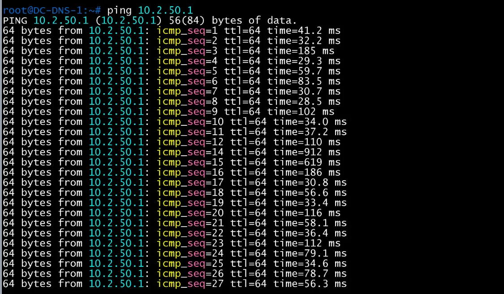
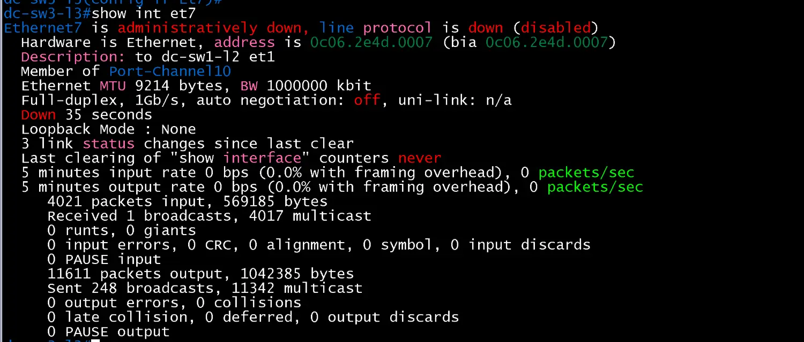
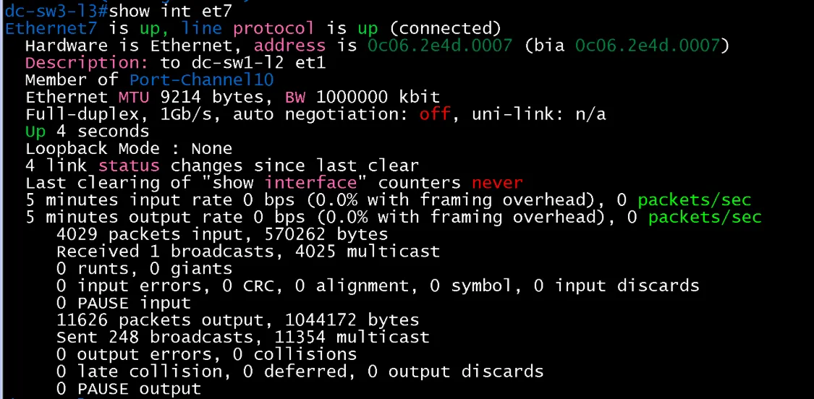
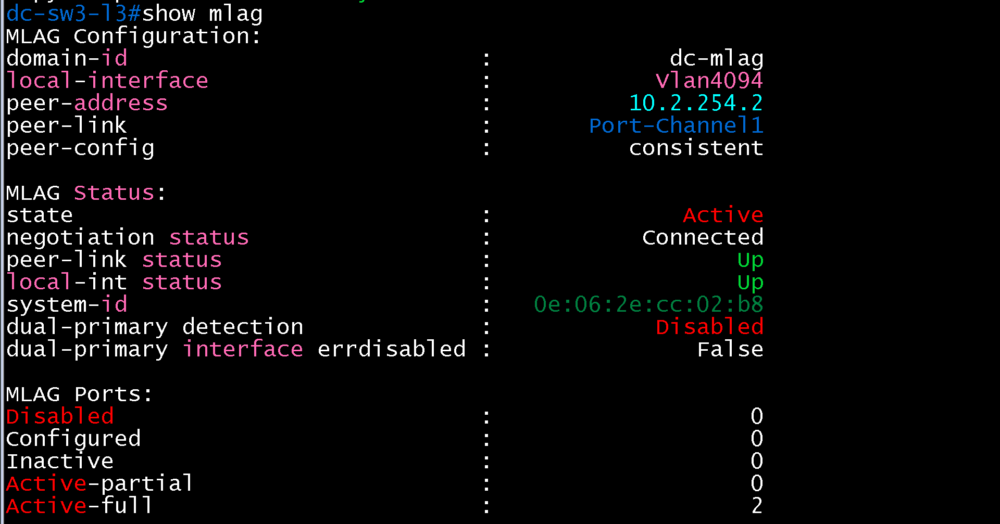

# MLAG 검증 (DC / distribution)

- Jira: KAN-37
- 대상 장비: DC-SW3-L3, DC-SW4-L3, DC-SW1-L2, DC-SW2-L2
- 기준 문서: [mlag-design.md](../../../docs/mlag-design.md)
- 검증일: 2026-10-18

| 장비 | 명령 | 기대 결과 | 실제 결과 | 판정 |
|---|---|---|---|---|
| DC-SW3-L3, DC-SW4-L3 | `show mlag` | State Active, Negotiation Connected, peer-link `Po1` Up | 두 스위치 모두 domain-id `dc-mlag`, local-interface `Vlan4094`, peer-link `Port-Channel1`, state Active, negotiation status Connected, peer-link status Up, local-int status Up, peer-config consistent, system-id `0e:06:2e:cc:02:b8`. DC-SW3-L3 peer-address `10.2.254.2`, DC-SW4-L3 peer-address `10.2.254.1`. MLAG Ports는 Active-full 2(Po10, Po20), Inactive 0 | 통과 |
| DC-SW3-L3, DC-SW4-L3 | `show mlag detail` | Config sanity consistent | 두 스위치 모두 peer-config consistent. DC-SW3-L3는 State `primary`(Peer `secondary`), DC-SW4-L3는 State `secondary`(Peer `primary`), State changes 2, Failover False, Hardware ready True, UDP heartbeat alive True, Heartbeat timeout 0(Last heartbeat timeout never), Heartbeats sent/received 179/176(SW3), 168/170(SW4), Reload delay 300 seconds | 통과 |
| DC-SW3-L3, DC-SW4-L3 | `show port-channel dense` | `Po1`(peer-link) Up, `Po10`, `Po20` Up(MLAG 포트채널) | 두 스위치 모두 채널 3개 사용. `Po1(U)` LACP(a) Et5(PG+) Et6(PG+), `Po10(U)` Et7(PG+) PEt7(P), `Po20(U)` Et8(PG+) PEt8(P)(P 접두는 MLAG 피어 쪽 멤버) | 통과 |
| DC-SW1-L2, DC-SW2-L2 | `show port-channel dense` | 업링크 Et1, Et2가 `Po10`, `Po20`로 묶여 Up | DC-SW1-L2: `Po10(U)` LACP(a) Et1(PG+) Et2(PG+). DC-SW2-L2: `Po20(U)` LACP(a) Et1(PG+) Et2(PG+) | 통과 |
| DC-SW1-L2, DC-SW2-L2 | `show lacp peer` | 두 파트너(SW3, SW4)와 LACP 협상(파트너 시스템 ID가 MLAG system-id) | DC-SW1-L2 `Po10`: Et1, Et2 Bundled, 파트너 시스템 ID `8000,0e-06-2e-cc-02-b8`(MLAG system-id와 동일), 파트너 포트 `7`(SW3 Et7), `32775`(SW4 Et7), State `ALGs+CD`. DC-SW2-L2 `Po20`: Et1, Et2 Bundled, 같은 파트너 시스템 ID, 파트너 포트 `8`(SW3 Et8), `32776`(SW4 Et8), State `ALGs+CD` | 통과 |
| DC-DNS-1 | `ping -c 3 10.2.50.1`, `nslookup dc-r1.lab.local 10.2.50.10` | MLAG 적용 후에도 게이트웨이와 DNS 응답 유지 | ping 3/3 응답(0% 손실, 지연 최소 32ms, 평균 158ms, 최대 401ms), `nslookup`이 `10.10.10.1`로 응답 | 통과 |
| DC-SW3-L3 | `int et7`에서 `shutdown` 후 DC-DNS-1의 연속 `ping 10.2.50.1`, `show int et7` | 다른 쪽으로 트래픽 유지, 복구 후 정상화 | `Ethernet7 is administratively down`(`Member of Port-Channel10`, Down 35 seconds). 연속 ping에서 `icmp_seq=13` 한 개 손실, `seq=14`(912ms)와 `seq=15`(619ms)에서 지연이 튀었다가 `seq=16`부터 30~110ms로 안정(약 1초 단절). `no shutdown` 후 `Ethernet7 is up, line protocol is up (connected)`(Up 4 seconds), `show mlag`가 Active-full 2, Inactive 0으로 복구. 다운 중 `Active-partial` 캡처는 없음(3주 EtherChannel 실측 때 보충 가능) | 통과 |

vEOS-lab의 MLAG 지원 여부는 `show mlag`로 먼저 확인하고, 미지원이면 판정란에 한계를 기록.

DC-SW3-L3 show mlag

DC-SW3-L3 show port-channel dense

DC-SW4-L3 show mlag

DC-SW4-L3 show port-channel dense

DC-SW1-L2 show port-channel dense

DC-SW1-L2 show lacp peer

DC-SW2-L2 show port-channel dense

DC-SW2-L2 show lacp peer

DC-DNS-1 ping 10.2.50.1

DC-DNS-1 nslookup

DC-DNS-1 연속 ping(SW3 Et7 다운 중)

DC-SW3-L3 show int et7(다운)

DC-SW3-L3 show int et7(복구)

DC-SW3-L3 show mlag(복구 후)

DC-SW3-L3 show mlag detail

DC-SW4-L3 show mlag detail

