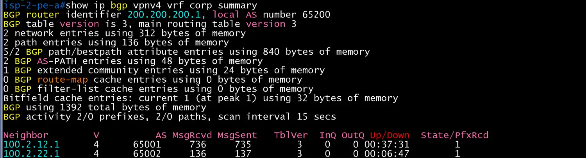
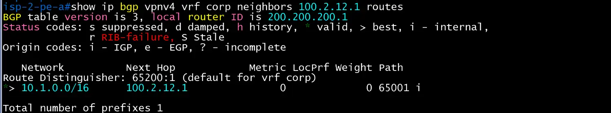
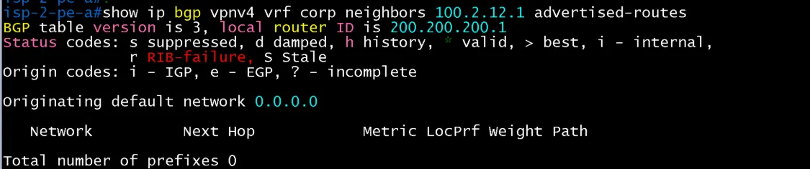
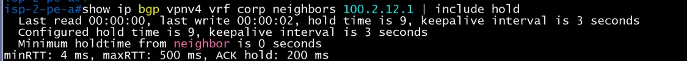
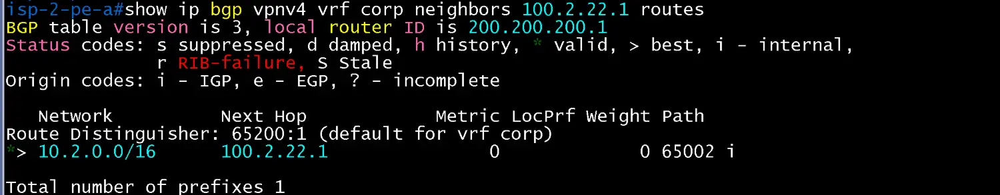
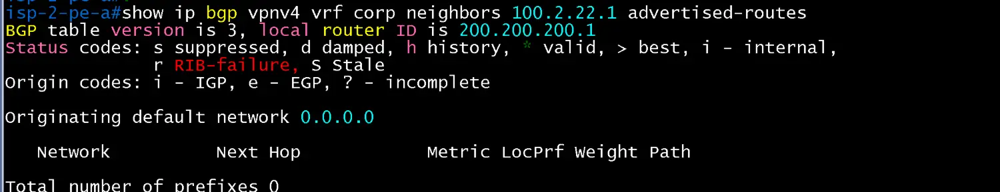
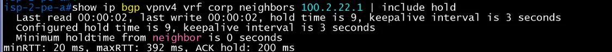

# BGP 검증(iBGP RR, 사이트 eBGP) (ISP2 / core)

- Jira: KAN-15, KAN-16(iBGP), KAN-17(PE 정책), KAN-18(사이트 eBGP)
- 대상 장비: ISP-2-PE-A, P1, P2, PE-B
- 기준 문서: [bgp-design.md](../../../docs/bgp-design.md) 2~6절
- 검증일: 2026-10-17

## 1. ISP 내부 OSPF와 iBGP (KAN-15, 16, 3주 수)

| 장비 | 명령 | 기대 결과 | 실제 결과 | 판정 |
|---|---|---|---|---|
| ISP-2-PE-A, PE-B, P1, P2 | `show ip ospf neighbor` | ISP 내부 이웃 Full(point-to-point), Loopback0 `200.200.200.1~4` 도달 | 모두 FULL/ -(Pri 0). P1은 200.200.200.1(PE-A), .4(PE-B), .3(P2) 3개, P2는 .1, .4, .2 3개, PE-A와 PE-B는 P1, P2 2개 | 통과 |
| ISP-2-P1, P2 | `show ip bgp summary` | AS 65200, PE-A, PE-B, 상대 RR과 Established(3세션) | AS 65200, P1(router-id 200.200.200.2)과 P2(200.200.200.3) 모두 이웃 3개(200.200.200.1, .3 또는 .2, .4)가 Up/Down 약 1시간 28분 이상 유지, State/PfxRcd 숫자(Established) | 통과 |
| ISP-2-PE-A, PE-B | `show ip bgp summary` | P1, P2와 iBGP Established(AS 65200) | PE-A(200.200.200.1)와 PE-B(200.200.200.4) 모두 P1(200.200.200.2), P2(200.200.200.3) 2세션 Established | 통과 |
| ISP-2-P1, P2 | `show ip bgp neighbors \| include Reflector` | PE-A, PE-B가 Route-Reflector Client | P1, P2 모두 `Route-Reflector Client` 2건(PE-A, PE-B). 대소문자를 구분하므로 `Reflector`로 필터 | 통과 |
| ISP-2 전체 | `show ip bgp neighbors \| include hold` | iBGP 세션 timers 3/9 | P1, P2는 이웃 3개, PE-A, PE-B는 이웃 2개 모두 `Configured hold time is 9, keepalive interval is 3 seconds` | 통과 |

ISP-2-P1 OSPF neighbor

ISP-2-PE-A OSPF neighbor

ISP-2-PE-B OSPF neighbor

ISP-2-P2 OSPF neighbor

ISP-2-P1 BGP summary

ISP-2-P2 BGP summary

ISP-2-PE-A BGP summary

ISP-2-PE-B BGP summary

ISP-2-P1 BGP neighbors Reflector

ISP-2-P2 BGP neighbors Reflector

ISP-2-P1 BGP neighbors hold

ISP-2-PE-A BGP neighbors hold

ISP-2-PE-B BGP neighbors hold

ISP-2-P2 BGP neighbors hold

## 2. 사이트 eBGP 세션 (KAN-18, 2주 월)

- 사이트 쪽 확인은 `*/core/isp-link.md`. 이 절은 PE 쪽 확인(VRF `corp` 안의 세션, `docs/mpls-design.md` 3절).

| 장비 | 명령 | 기대 결과 | 실제 결과 | 판정 |
|---|---|---|---|---|
| ISP-2-PE-A | `show ip bgp vpnv4 vrf corp summary` | HQ-R2(100.2.12.1), DC-R4(100.2.22.1)와 eBGP Established | HQ-R2(100.2.12.1, AS 65001) Up/Down 00:37:31, DC-R4(100.2.22.1, AS 65002) Up/Down 00:06:47 모두 Established, PfxRcd 각 1 | 통과 |
| ISP-2-PE-B | `show ip bgp vpnv4 vrf corp summary` | BR1-R2(100.2.32.1), BR2-R2(100.2.42.1)와 eBGP Established | - | 미확인 |
| ISP-2-PE-A, PE-B | `show ip bgp vpnv4 vrf corp neighbors <사이트 주소> advertised-routes` | 사이트에는 기본 경로만 전달(`default-originate`, `pl-deny-all`) | PE-A는 HQ-R2, DC-R4 모두 `Originating default network 0.0.0.0`만 전송(일반 prefix 0개). PE-B는 BR 구성 후 | PE-A 통과, PE-B 미확인 |
| ISP-2-PE-A, PE-B | `show ip bgp vpnv4 vrf corp neighbors <사이트 주소> routes` | 해당 사이트 /16만 수신(`pl-<사이트>-in`) | PE-A는 HQ-R2 이웃에서 `10.1.0.0/16`(Path 65001 i), DC-R4 이웃에서 `10.2.0.0/16`(Path 65002 i) 각 1개만 수신, RD 65200:1. PE-B는 BR 구성 후 | PE-A 통과, PE-B 미확인 |
| ISP-2-PE-A, PE-B | `show ip bgp vpnv4 vrf corp neighbors <사이트 주소> \| include hold` | eBGP 세션 timers 3/9 | PE-A는 HQ-R2, DC-R4 이웃 모두 hold time 9, keepalive 3초(Configured도 동일). PE-B는 BR 구성 후 | PE-A 통과, PE-B 미확인 |

ISP-2-PE-A VRF summary

ISP-2-PE-A HQ-R2 routes

ISP-2-PE-A HQ-R2 advertised-routes

ISP-2-PE-A HQ-R2 hold

ISP-2-PE-A DC-R4 routes

ISP-2-PE-A DC-R4 advertised-routes

ISP-2-PE-A DC-R4 hold

## 3. PE 정책과 사이트 간 경로 (KAN-17, 3주 목)

| 장비 | 명령 | 기대 결과 | 실제 결과 | 판정 |
|---|---|---|---|---|
| ISP-2-PE-A, PE-B | `show ip bgp vpnv4 all` | 사이트 /16을 eBGP로 수신하고 상대 PE의 사이트 /16을 RR 경유로 수신(next-hop은 상대 PE Loopback0, `next-hop-self`) | - | 미확인 |
| ISP-2-P1, P2 | `show ip bgp vpnv4 all` | 모든 사이트 /16 반사, `Originator`, `Cluster list` 표시 | - | 미확인 |
